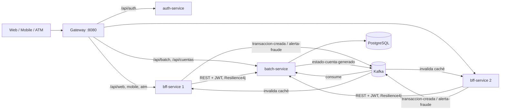

# Arquitectura propuesta

## 1. Procesos clave identificados para la migración (5)

| # | Proceso | Por qué es crítico | Dónde está |
|---|---|---|---|
| 1 | Migración de procesos batch a **Spring Batch** | Los cierres (intereses, transacciones, estados) deben ser tolerantes a fallos y reprocesables | `batch-service` |
| 2 | División del monolito en **microservicios** | Permite escalar y desplegar por separado lo que tiene carga distinta | 4 servicios + gateway |
| 3 | Patrón **BFF** (Web, Mobile, ATM) | Cada canal tiene necesidades distintas de datos, rendimiento y seguridad | `bff-service` |
| 4 | **Seguridad distribuida** | Cada servicio valida el token; los roles separan canales | `auth-service` + resource servers |
| 5 | **Mensajería asíncrona** con Kafka | Desacopla servicios y permite procesar retiros/alertas sin bloquear al cliente | topics `transaccion-creada`, `alerta-fraude`, `estado-cuenta-generado` |

## 2. Diagrama

## 3. Requerimientos de negocio y decisiones justificadas

| Requerimiento de negocio | Decisión | Justificación |
|---|---|---|
| Los cierres batch no pueden perder ni duplicar datos | Spring Batch con reintentos acotados, *skip* solo de registros inválidos y escrituras `ON CONFLICT` | Reprocesar un archivo da el mismo resultado; los errores reales no se esconden |
| Cada canal con necesidades distintas | Un BFF con DTO, seguridad y política de caché propios por canal | Mobile recibe lo mínimo; Web la vista completa; ATM nunca usa caché (saldo real) |
| Seguridad financiera | JWT firmado, validado en cada servicio (no solo en la entrada), roles por canal, secretos por variables de entorno sin valores por defecto | Un servicio comprometido o expuesto no confía ciegamente en el gateway |
| Disponibilidad ante caída de un servicio | Circuit Breaker + Retry (Resilience4j) hacia `batch-service`; respuesta 503 controlada | Evita colapso en cascada y respuestas colgadas |
| Retiro rápido sin bloquear al cliente | Evento Kafka + respuesta 202; el saldo se actualiza al consumir | Desacopla BFF y datos; consistencia eventual aceptada (se revalida el saldo al consumir) |
| Crecer en cantidad de usuarios | BFF sin estado, 2 réplicas detrás del gateway (LoadBalancer) | Escalar horizontalmente solo el componente de mayor tráfico |
| Entornos reproducibles | Docker multi-stage + Docker Compose; PostgreSQL con volumen | `docker compose up --build` levanta todo igual en cualquier equipo |

## 4. Consistencia del saldo

`saldoDisponible = saldo base (job de intereses) + depósitos PROCESADOS − retiros PROCESADOS`.
Un retiro del ATM se valida en el BFF, se publica como evento y `batch-service` lo vuelve a validar
al guardarlo (si el saldo cambió, queda `RECHAZADA`). Los eventos se descartan si el `eventoId` ya
fue procesado (entrega Kafka "al menos una vez").
